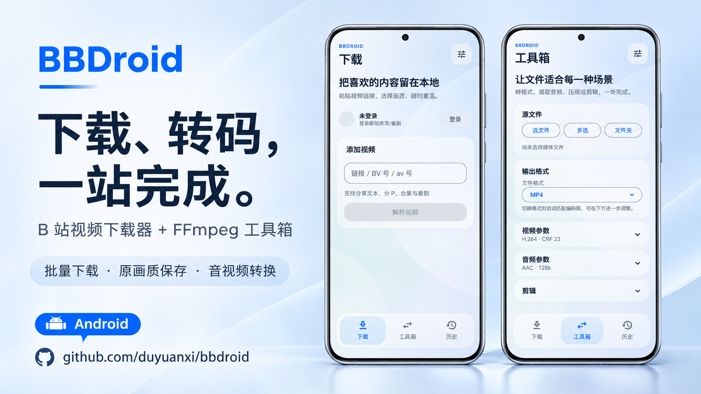
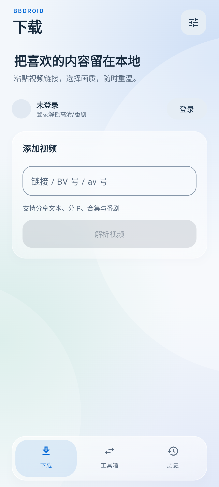
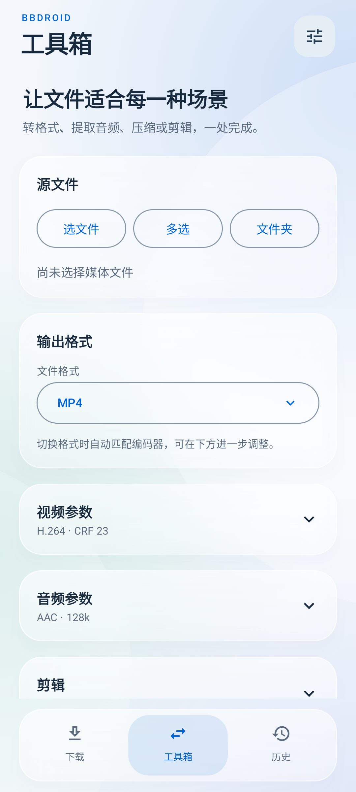
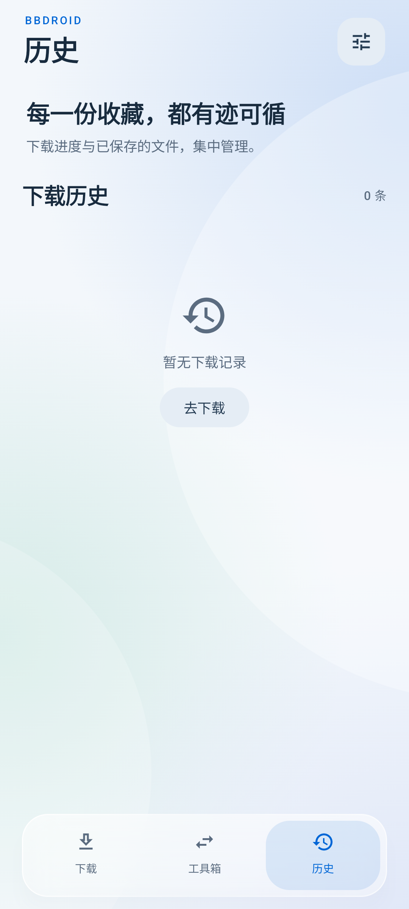

<div align="center">

# BBDroid

**下载、转码，一站完成。**

B 站视频下载器 + FFmpeg 工具箱，把视频保存、格式转换和文件管理装进一个 Android 应用。

[下载 APK](https://github.com/duyuanxi/bbdroid/releases/latest) · [功能亮点](#功能亮点) · [界面预览](#界面预览) · [快速上手](#快速上手) · [源码构建](#源码构建)

**Android 7.0+ · Kotlin · Jetpack Compose · FFmpeg**



</div>

## 功能亮点

### 喜欢的内容，一次保存

- **从单条视频到整个列表**：支持单视频、分 P，以及合集、系列、番剧、收藏夹和 UP 主投稿列表的批量下载。
- **画质、编码自己选**：选择视频源提供的清晰度与 AVC / HEVC / AV1 编码，涵盖 1080P 高帧率、4K、HDR、杜比视界、8K 等档位。
- **保留所选流的画质**：音视频分别下载后，通过 FFmpeg `-c copy` 自动合并为 MP4，无需再次压缩。
- **配套内容一起带走**：按需保存封面、XML 弹幕与 SRT 字幕；字幕取决于视频源是否提供。
- **下载过程看得见**：显示进度、速度与批量任务状态，支持分段并行下载及备用 CDN 切换。

> 高清、会员及番剧内容需要对应的账号权限，实际可选画质与编码以视频源返回结果为准。应用提供网页登录与扫码登录。

### 下载之后，直接处理

下载完成后可一键导入工具箱，继续转换格式、提取音频或剪辑，无需重新寻找文件。

| 想做什么 | 工具箱提供什么 |
| --- | --- |
| 转换视频格式 | MP4、MKV、MOV、AVI、FLV、WMV、WebM、MPEG-TS 等输出格式 |
| 调整视频编码 | H.264、H.265 / HEVC、AV1、VP9、MPEG-4，以及 H.264 / H.265 硬件编码选项 |
| 控制体积与清晰度 | CRF 或视频码率、输出分辨率、帧率设置 |
| 处理音频 | MP3、AAC、FLAC、WAV、OGG、M4A 等格式，以及音频码率、声道、采样率、音量设置 |
| 只保留需要的流 | 复制音视频流进行封装，或关闭视频 / 音频流 |
| 截取一段内容 | 设置开始时间和输出时长 |
| 一次处理多个文件 | 单文件、多文件、文件夹导入及批量转码 |
| 查看媒体信息 | 通过 ffprobe 读取格式与流信息 |

格式、编码与参数需要相互兼容；硬件编码还取决于设备支持情况。工具箱内置 FFmpeg 引擎，无需另行安装命令行工具。

### 保存、查找、分享，顺手完成

- **下载历史**：集中查看已保存内容，打开播放、分享或重新下载。
- **自定义保存位置**：默认视频目录为 `Download/BBDroid/视频/`，也可在设置中选择文件夹。
- **附赠文件独立保存**：Android 10 及以上将封面、弹幕和字幕写入 `Download/BBDroid/附赠/`。
- **按习惯选择外观**：浅色、深色、跟随系统，以及可调强度的液态玻璃主题。

## 界面预览

以下为本地开发构建的真实运行截图，采集于 Android 模拟器；发布版界面以对应安装包为准。海报基于下载页与工具箱截图制作。

<table>
  <tr>
    <th align="center">视频下载</th>
    <th align="center">FFmpeg 工具箱</th>
    <th align="center">下载历史</th>
  </tr>
  <tr>
    <td width="33%"></td>
    <td width="33%"></td>
    <td width="33%"></td>
  </tr>
</table>

## 快速上手

1. 前往 [Releases](https://github.com/duyuanxi/bbdroid/releases/latest)，下载 `app-release.apk` 并安装。最低支持 Android 7.0（API 24）。
2. 打开下载页，粘贴 B 站视频链接、BV 号或 av 号并解析。需要账号权限的内容先在设置中登录。
3. 选择分 P、画质、编码及附赠内容，下载单条视频或加入批量队列。
4. 完成后打开或分享文件；需要调整格式、体积或片段时，选择「导入转码」。

处理已有的本地文件，直接进入工具箱选择文件、多选文件或导入文件夹，再设置输出参数并开始转码。

## 源码构建

### 环境与依赖

- JDK 17 或更新版本。
- Android SDK 34；项目的 `compileSdk` 与 `targetSdk` 均为 34，`minSdk` 为 24。
- 使用仓库自带的 Gradle Wrapper。
- 本地 FFmpeg AAR：[`app/libs/ffmpeg-kit-full-gpl-8.1.7.aar`](app/libs/ffmpeg-kit-full-gpl-8.1.7.aar)，已随仓库提供。

在项目根目录运行：

```powershell
# Windows：构建 Debug 安装包
.\gradlew.bat :app:assembleDebug

# Windows：构建 Release 安装包
.\gradlew.bat :app:assembleRelease
```

```bash
# macOS / Linux
bash ./gradlew :app:assembleDebug
```

Debug 输出位于 `app/build/outputs/apk/debug/app-debug.apk`。生成已签名的 Release 安装包，需要先完成下面的签名配置。

### Release 签名

在项目根目录新建 `keystore.properties`：

```properties
storeFile=release.keystore
storePassword=你的密码
keyAlias=你的别名
keyPassword=你的密码
```

将对应密钥文件放到 `app/release.keystore`。`keystore.properties` 与 `*.keystore` 已在 `.gitignore` 中排除。

### 项目结构

```text
app/src/main/java/com/bbdroid/app/
├── MainActivity.kt       # 下载 / 工具箱 / 历史与设置入口
├── DownloadTab.kt        # 视频解析、分 P 与批量下载
├── Downloader.kt         # 音视频下载、合并与附赠内容
├── ToolboxTab.kt         # 文件导入、转码参数与媒体信息
├── FfmpegOptions.kt      # 输出格式、编码与命令构建
├── FFmpegEngine.kt       # FFmpeg 引擎调用
├── HistoryTab.kt         # 下载历史、打开与分享
├── Storage.kt            # 文件保存与自定义目录
├── SettingsStore.kt      # DataStore 设置持久化
├── Db.kt                 # Room 数据存储
└── bilibili/             # B 站解析、接口与 WBI 签名
```

技术栈：Kotlin · Jetpack Compose / Material 3 · Room · DataStore · OkHttp · ZXing · FFmpegKit。

## 开源协议

应用代码使用 [MIT License](LICENSE)。FFmpegKit 及其内置编解码器分别遵循各自的开源协议；本项目使用的 `full-gpl` 版本包含 GPL 组件，相关分发须遵守对应协议。
